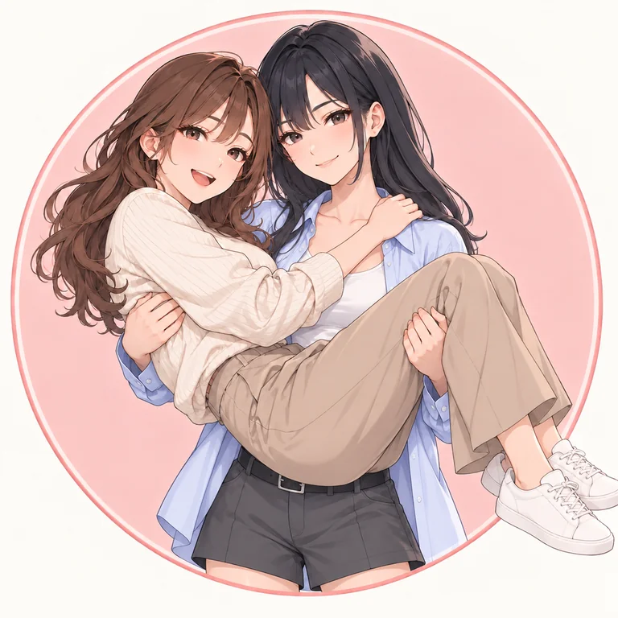

# 拾幕工作室

我们运营「抱抱日常 AIGC」账号，创作二次元女抱女短视频，分享温柔日常。

网站：<https://shimustudio.github.io/>



## 本地开发

使用 Node.js 24 和 npm：

```sh
npm ci
npm run dev
```

## 构建与发布

```sh
npm run build
npm run preview
```

Vite 构建产物位于 `dist/`，作为纯静态网站部署。发布时在 [部署工作流](https://github.com/ShiMuStudio/ShiMuStudio.github.io/actions/workflows/pages.yml) 中选择 `main`，手动运行。Push 不会自动发布。

本仓库保持公开，保留网站所需的六张压缩 WebP 展示图。开发与构建按 [网站资源清单](site/assets-manifest.json) 校验 SHA256，Vite 将 `site/public/` 内的图片原样复制到产物；普通构建无需访问私有仓库或配置访问令牌。

顶部图标使用圆徽章 Logo，首页使用方形 Logo，角色区展示拾夏、幕宁、林柚 168 cm 与苏遥 173 cm 的完整三视图，点击可查看图片。

## 素材维护

源图、原始生成／编辑提示词、角色设定、四人合照与来源记录的权威目录位于私有 [production-kit 的 branding/](https://github.com/ShiMuStudio/production-kit/tree/main/branding)。本仓库的 `branding/` 不再纳入版本管理。

在拥有素材仓库访问权限的本地环境更新素材：

```sh
git clone https://github.com/ShiMuStudio/production-kit.git ../production-kit
# 在素材仓库提交 branding/ 更新后导出展示副本
npm run assets:sync -- ../production-kit
npm run build
```

同步脚本先验证所有原图 SHA256，再导出 WebP 展示图（Logo 最长边 768 px、角色最长边 1024 px，质量 85），并记录素材仓库提交。原图不写入公开仓库。审阅并提交展示图与清单，即可按现有工作流部署。

公开页面的图片仍可下载。构建校验会拒绝追踪源图、原始提示词或未经清单允许的图片；清理历史后，请重新克隆网站仓库，避免把旧素材历史合并回来。

两版 Logo 保留拾夏抱幕宁的双人构图。四人合照保存在素材库，配对为拾夏公主抱幕宁、苏遥背林柚。
