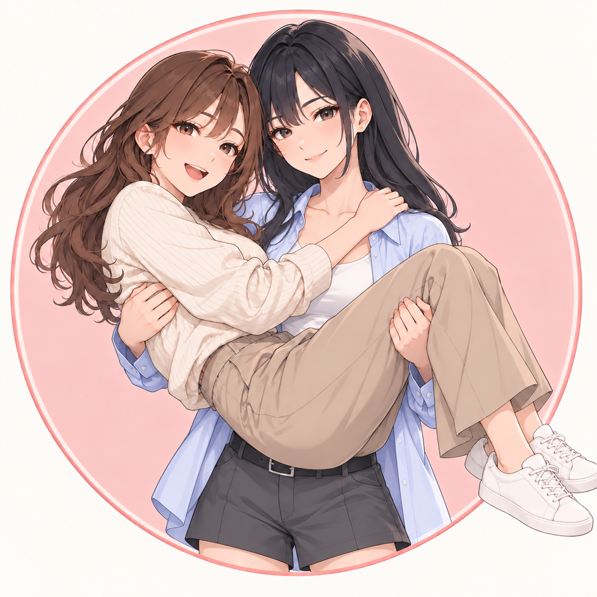

# 拾幕工作室

我们运营「抱抱日常 AIGC」账号，创作二次元女抱女短视频，分享温柔日常。

网站：<https://shimustudio.github.io/>



## 本地开发

使用 Node.js 24 和 npm：

```sh
npm ci
npm run dev
```

## 构建与发布

```sh
npm run build
npm run preview
```

Vite 构建产物位于 `dist/`，可直接作为纯静态网站部署。发布时在 [部署工作流](https://github.com/ShiMuStudio/ShiMuStudio.github.io/actions/workflows/pages.yml) 中选择 `main`，手动运行。Push 不会自动发布。

## 品牌素材

保留新版 Logo、两张人设三视图和对应的三个原始提示词，共六个素材文件：

| 素材 | 图片 | 生成提示词 |
| --- | --- | --- |
| 蓝衬衫新版 Logo（v3） | [Logo](branding/studio-logo-v3.png) | [prompt](branding/studio-logo-v3.prompt.txt) |
| 抱人女孩三视图（v6） | [人设图](branding/characters/carrier-blue-shirt-turnaround-v6.png) | [prompt](branding/characters/carrier-blue-shirt-turnaround-v6.prompt.txt) |
| 被抱女孩三视图（v6） | [人设图](branding/characters/carried-tucked-turnaround-v6.png) | [prompt](branding/characters/carried-tucked-turnaround-v6.prompt.txt) |

抱人女孩采用浅蓝敞开衬衫、白色内搭、灰色高腰短裤、白袜与黑色搭扣鞋；被抱女孩保留原来的棕色卷发、奶白针织衫收进裤腰、米色高腰宽腿布裤与白鞋。三视图包含正面、侧面和背面，暂按抱人女孩 172 cm、被抱女孩 170 cm 绘制，身高对应关系尚未明确指定。

[品牌清单](branding/manifest.json) 与 [人物素材清单](branding/characters/manifest.json) 记录图片和提示词的 SHA256。三个提示词保留生成时的原文，旧稿已移到本地归档。

[拾夏与幕宁角色设定草案](branding/characters/profiles.md) 补充姓名、大学生身份、年龄、年级、性格及两人关系：拾夏为蓝衬衫抱人女孩，幕宁为奶白针织衫被抱女孩；新增文字设定供 PR review。
